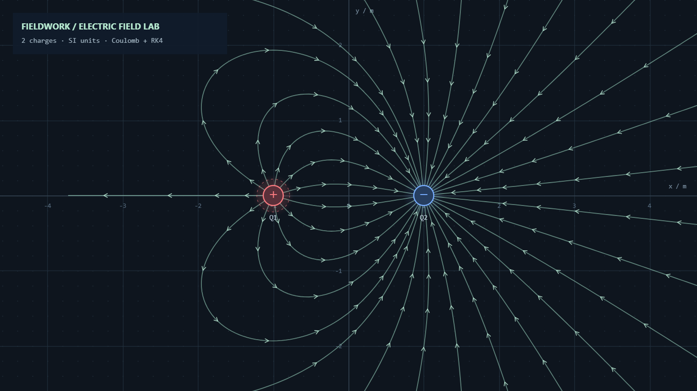

# FIELDWORK — Electric Field Lab
### Interactive Electric Field Visualizer

A browser-based 2D electric field simulator built with vanilla JavaScript and HTML Canvas.

Visualize electric field lines generated by multiple point charges using Coulomb's law and numerical integration.



**[Live Demo](https://wkreho.github.io/electric-field-visualizer/)**

## Features

- **Custom Point Charges:** Add, move, rename, edit, and delete positive or negative charges.
- **Interactive Field Lines:** Visualize curved electric field lines with directional arrows.
- **Field Strength Visualization:** Adjust arrow spacing based on local electric field strength.
- **Interactive Canvas:** Zoom, pan, and maximize the visualization.
- **Field Measurements:** Inspect electric field components and magnitude at any position.
- **Save & Export:** Save configurations as JSON and export visualizations as PNG.

## Quick Start

Open `index.html` in your browser, or run a local server:

```bash
python -m http.server 8000
```

Then visit `http://localhost:8000`.

No external libraries or build tools are required.

## Physics

The electric field is calculated using Coulomb's law and the superposition principle:

\[
\vec E(\vec r)=\sum_i kq_i\frac{\vec r-\vec r_i}{|\vec r-\vec r_i|^3}
\]

Field lines are numerically integrated using the fourth-order Runge-Kutta method (RK4).

---

See the sections below for detailed controls, numerical methods, limitations, and testing instructions.

Vanilla JavaScript와 Canvas 2D로 만든 인터랙티브 2D 전기장 실험실입니다. 외부 라이브러리, 폰트 다운로드, 빌드, 계정이 필요하지 않습니다. 시작 배치는 Electric Dipole입니다.

## 실행

가장 간단한 방법: **`index.html`을 Chrome 또는 Edge에서 열기**. `file://`에서도 모든 기능이 작동하며, 계산은 메인 스레드에서 실행합니다. 전하를 많이 배치할 때는 아래 로컬 서버 방식을 권장합니다. 서버에서는 Web Worker로 계산하여 조작 화면과 분리합니다.

```powershell
cd "C:\Users\SEC\Desktop\htmlCssJS\개인\개인\electric_field_visualizer"
python -m http.server 8000 --bind 127.0.0.1
```

브라우저에서 <http://127.0.0.1:8000>을 엽니다. 포트가 사용 중이면 8000을 8001 등으로 바꾸세요. 종료는 서버 터미널에서 `Ctrl+C`입니다.

Python 없이 Node.js가 있다면:

```powershell
node serve.cjs 8000
```

Python과 Node.js 모두 없더라도 `index.html`을 직접 열면 됩니다. 최신 Chrome / Edge / Firefox 등 Canvas 2D, ResizeObserver, HTML dialog를 지원하는 브라우저가 필요합니다. 실제 브라우저 검증은 이 작업 환경의 Chromium 기반 브라우저에서 수행했습니다.

## 사용 방법

- **추가**: 양전하 / 음전하 도구를 선택하고 빈 좌표평면을 클릭합니다. 기본값은 ±1 nC입니다. 추가 모드는 계속 유지되어 연속 배치할 수 있습니다.
- **선택·이동**: 전하 또는 목록 항목을 클릭합니다. 전하를 드래그하거나 편집기의 X, Y를 입력하고 `변경 적용`을 누릅니다. 추가 도구에서도 기존 전하를 드래그할 수 있습니다.
- **이름**: 속성 패널의 이름을 편집하고 `변경 적용`을 누릅니다. 목록·선택 표시·Field 라벨에 같은 이름이 반영됩니다. 이름은 40자 이하의 한 줄 텍스트이며, 빈 이름과 대소문자만 다른 중복 이름은 허용하지 않습니다. 앞뒤 공백과 중복 공백은 정리합니다. 새 전하에는 현재 비어 있는 가장 작은 Q 번호를 부여하므로 Q2를 삭제하면 Q2를 재사용하고, 모든 전하를 지우면 Q1부터 시작합니다. 내부 ID는 표시 이름과 별개이므로 이름을 바꿔도 선택·편집·드래그·삭제가 유지됩니다.
- **전하량**: C 단위 숫자를 입력하고 `변경 적용` 또는 Enter를 누릅니다. `1e-9`, `-2e-9`, `3.5e-6`, `-0.001`, `0`을 지원합니다. `1e-9 C = 1 nC`, `1e-6 C = 1 μC`입니다. 빠른 ±1 nC 버튼과 부호 반전을 제공합니다.
- **삭제**: 편집기 삭제 버튼, 목록 ×, 또는 캔버스에 초점이 있는 상태의 Delete / Backspace를 사용합니다. 전체 삭제는 화면 내 확인창에서 확인해야 합니다.
- **화면 조작**: 빈 공간 드래그, 이동 도구 또는 Space + 드래그로 화면을 옮깁니다. 마우스 휠은 커서 아래 물리 좌표를 유지하며 확대합니다. `전체 보기`는 모든 전하에 화면을 맞추고, `뷰 초기화`는 원점과 기본 확대율을 복원합니다. 물리 좌표는 화면 조작으로 바뀌지 않습니다.
- **측정**: 캔버스 위에 마우스를 두면 실제 좌표, Ex, Ey, |E| 및 +X 기준 반시계 방향 각도가 표시됩니다. 작은 벡터도 합성 전기장 방향을 가리킵니다. 전기장이 0인 위치에서는 방향을 표시하지 않으며, 점전하 중심은 특이점으로 안내합니다.
- **시각화**: 전기력선 밀도, 화살표 밀도, 선 굵기, 화살표 크기를 독립적으로 조절합니다. 화살표와 격자를 개별적으로 숨길 수 있습니다. 작은 화면에서는 왼쪽 패널을 스크롤하고, 휴대전화 세로 화면에서는 패널이 캔버스 아래로 이동합니다.
- **Field 최대화**: Field 오른쪽 아래의 펼치기 아이콘으로 브라우저 내부 전체를 Field에 할당합니다. 복원 아이콘 또는 Esc로 돌아옵니다. 브라우저 F11과 별개이며, 전하의 물리 좌표·카메라 중심·px/m 확대율을 유지합니다. 최대화 중에는 왼쪽 위의 작은 선택·양전하·음전하·이동 도구를 사용하고, 휠·드래그·단축키도 그대로 사용할 수 있습니다. 측정 패널에는 최대화 중에도 X, Y와 전기장 수치가 표시됩니다.
- **Field 내부 스위치**: 오른쪽 위 `Arrows` / `Grid`는 사이드바의 방향 화살표 / 좌표 격자와 양방향 동기화됩니다. `필드 내부 컨트롤 표시`는 이 두 스위치 자체만 숨깁니다. 실제 화살표·격자 상태나 최대화·복원 버튼에는 영향을 주지 않습니다. 숨긴 컨트롤을 다시 표시하려면 복원 후 사이드바 옵션을 켭니다.
- **예제**: 단일 양전하, 단일 음전하, 쌍극자, 두 양전하, +1 / −3 nC 배치를 제공합니다. 프리셋 선택은 기존 전하를 교체합니다.

| 단축키 | 동작 |
|---|---|
| V / H | 선택 / 화면 이동 |
| + / − | 양전하 / 음전하 추가 |
| Space + 드래그 | 임시 화면 이동 |
| F | 모든 전하 보기 |
| Delete / Backspace | 선택 전하 삭제 |
| Esc | Field 최대화 해제 / 선택 도구 / 열린 확인창 닫기 |

입력 필드에서는 단축키가 숫자 입력을 방해하지 않습니다.

## 저장과 불러오기

`JSON 저장`은 `fieldwork-scene.json`을, `이미지 저장`은 `fieldwork-electric-field.png`를 브라우저 다운로드 폴더에 저장합니다. 실제 저장 위치는 브라우저 설정에 따릅니다. PNG는 격자·전기력선·전하·선택 표시와 간단한 제목을 포함하고, 측정 커서와 편집 패널은 제외합니다. 최신 계산이 진행 중이면 완료 후 저장합니다.

`불러오기`에서 저장된 JSON을 선택하면 전하의 이름·위치·전하량, 화면 중심·확대율, 시각화 설정을 복원합니다. 검증을 통과한 전체 데이터만 한 번에 적용하므로 잘못된 파일은 현재 배치를 바꾸지 않습니다. 유효한 내부 ID는 유지하고, 없는 ID는 자동 부여합니다. 기존 version 1 파일도 지원합니다. 이름이 없는 과거 파일에는 Q1, Q2 등의 이름을 부여하고, `showFieldControls`가 없으면 기본 ON을 적용합니다. 명시된 이름·ID가 중복된 파일은 오류를 안내합니다.

```json
{
  "version": 1,
  "charges": [{ "id": 1, "name": "Left Charge", "x": -1, "y": 0, "q": 1e-9 }],
  "view": { "x": 0, "y": 0, "scale": 130 },
  "settings": {
    "lineDensity": 32, "arrowDensity": 1, "lineWidth": 1.2,
    "arrowSize": 5, "showArrows": true, "showGrid": true,
    "showFieldControls": true
  }
}
```

위치는 m, 전하량은 C, `view.scale`은 CSS px/m입니다. 배치는 자동 저장되지 않습니다. 최대화 여부는 임시 레이아웃 상태이므로 JSON에 저장하지 않습니다. 새로고침 전 필요한 배치를 JSON으로 보관하세요. 실제 저장·불러오기 검증에 사용한 예제와 화면 캡처는 `artifacts/`에 있습니다.

## 물리 모델 및 수치 계산

`k = 8.9875517923 × 10⁹ N·m²/C²`와 쿨롱 법칙 `E = Σ kq(r−ri)/|r−ri|³`을 사용합니다. 화면은 2차원이지만 **3차원 점전하의 전기장을 한 평면에서 관찰하는 모델**입니다. 2차원 로그 퍼텐셜 모델이 아닙니다. 방향 계산은 최대 전하량으로 정규화하여 아주 작은 전하도 절대 임계값 때문에 사라지지 않도록 합니다. 전하 중심에서 fieldAt은 특이점 상태를 반환하며, 물리식에 임의의 softening을 넣지 않습니다.

전기력선은 `dr/ds = E/|E|`를 RK4로 적분합니다. 전체 스텝과 반 스텝 두 번의 오차를 비교하여 굽은 영역에서는 스텝을 줄이고, 가장 가까운 전하까지의 거리로 스텝 크기를 제한합니다. 계산점 사이에는 짧은 직선 세그먼트를 사용하며 임의의 베지어 곡선을 만들지 않습니다.

양전하에서 정방향, 음전하에서 역방향으로 추적합니다. 역방향 추적이 양전하에 도달한 선은 중복 연결을 줄이기 위해 제외합니다. 음전하만 있어도 선이 생성되며, **화살표는 추적 순서가 아니라 그 위치의 실제 E 방향**으로 그립니다. 전하가 전부 화면 밖에 있을 때는 경계로 유입하는 실제 전기장 방향에서 선을 추적합니다.

선 개수는 전하량에 비례하는 기본 배분에 최소 6개(전체 예산 축소 시 최소 3개)를 적용합니다. 기본 밀도 32는 가장 큰 전하에 대한 출발 샘플 수이며, 최종 표시되는 선 개수와 다릅니다. 총 출발 샘플 예산은 640개입니다. 아주 작은 전하도 독립적인 출발점을 갖습니다. 같은 좌표의 전하는 적분에서 합성하여 중복을 제거하고, 편집기에는 개별 전하를 유지합니다.

화살표 간격은 화면 내 18×14 샘플의 |E|를 로그 변환하고 5–95 백분위 범위로 정규화합니다. 강한 전기장에서는 촘촘해지고, 약한 영역에서는 넓어집니다. 간격은 화면 기준 22–180px로 제한하고, 공간 격자로 인접 화살표의 겹침을 줄입니다. 전하 바로 위에는 화살표를 그리지 않습니다. 화살표 밀도는 선의 개수와 별도입니다.

## 성능과 한계

- 전하 최대 200개, 좌표 ±1e9 m, 전하량 절댓값 최대 1e6 C, JSON 최대 2 MB입니다. 유한한 수와 과학적 표기법만 허용하며 JS 표현 범위를 벗어난 오버플로·언더플로 입력을 거부합니다. 화면 확대 범위는 1e-9–1e6 px/m입니다.
- 전하 중심의 적분 종료 반경은 기본 13 화면 픽셀에 해당하는 거리이며, 인접 전하 간격의 18% 이하로 줄입니다. 선은 전하 도달, 화면 이탈, 상쇄 영역, 최대 길이 또는 2,200스텝에서 종료합니다.
- Web Worker가 한 번에 하나의 계산만 수행합니다. 드래그 중 요청은 최신 상태만 남기고, 오래된 결과는 버립니다. 전하 표시와 편집기는 즉시 바뀌고, 최종 전기력선은 계산 완료 후 갱신됩니다. 설정과 카메라 조작은 물리적 전하량·좌표를 바꾸지 않습니다.
- 수치 적분·유한 개수 샘플링으로 전기장을 근사합니다. 극단적으로 가까운 전하, 매우 큰 전하량 비율, 상쇄점 부근에서는 부동소수점 정밀도·선 샘플링의 한계가 있습니다. 전하 심볼이 겹칠 때는 목록에서 각각 선택할 수 있습니다.
- 최소 선 개수 및 최대 예산 때문에 선의 개수를 정확한 정량적 전속으로 해석하면 안 됩니다. 전속의 3차원 구면 분포를 정확히 재현하는 3D 시뮬레이터가 아닙니다.
- 시각화는 정전기장입니다. 시간에 따른 입자 운동, 전도체 경계, 자기장은 범위에 포함하지 않습니다. 상태 되돌리기나 자동 저장은 제공하지 않습니다.

## 파일 구성

```text
electric_field_visualizer/
├── index.html                 화면·접근성·입력 요소
├── css/style.css              기본 반응형 다크 테마
├── css/field-controls.css     간결한 레이아웃·내부 컨트롤·최대화
├── js/
│   ├── main.js                상태·포인터·카메라·파일·계산 일정
│   ├── physics.js             쿨롱 법칙·좌표 변환·이름 및 데이터 검증
│   ├── fieldLines.js          RK4·적응형 적분·출발점·밀도
│   ├── renderer.js            HiDPI Canvas·격자·화살표·PNG
│   ├── ui.js                  편집기·목록·설정·단축키
│   └── worker.js              별도 스레드 계산
├── tests/physics.test.cjs      기존 물리 자동 테스트
├── tests/metadata.test.cjs     이름·호환성·5개 프리셋 회귀 테스트
├── tests/fixtures/            수정 전 전기력선 수치 기준값
├── artifacts/                 실제 저장 결과·테스트 기록
├── serve.cjs                  Node.js 대체 로컬 서버
└── README.md
```

## 자동 테스트

Node.js 18 이상에서 프로젝트 폴더 내 다음을 실행합니다.

```powershell
node --test tests/physics.test.cjs tests/metadata.test.cjs
```

별도 패키지 설치는 필요 없습니다. 총 23개 테스트에서 기존 물리·좌표 변환 검증에 더해 이름 재사용, 이름 검증, 내부 ID 보존, 구버전 JSON, 컨트롤 표시 상태, 사용자 이름의 저장·복원을 검사합니다. 5개 프리셋은 수정 전에 캡처한 모든 선의 계산점(소수점 7자리 기준)과 비교합니다. 이번 업데이트의 실제 브라우저 검증 내역은 `artifacts/UPDATE_TEST_RESULTS.md`, 최초 제작 시 기록은 `artifacts/TEST_RESULTS.md`에 있습니다.
