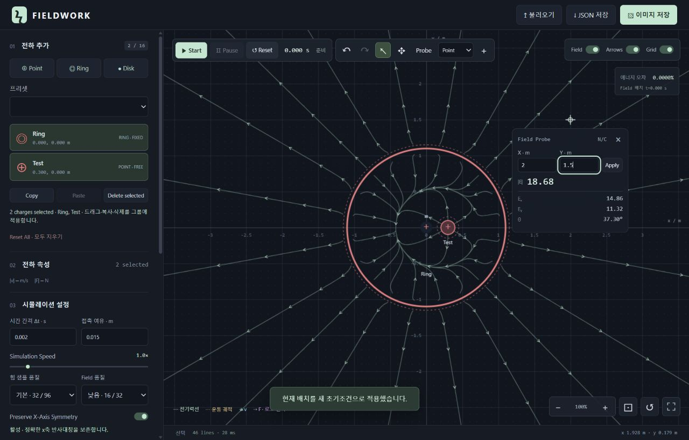

# FIELDWORK — Electric Field & Charge Motion

FIELDWORK is an interactive, browser-based electric field and charge motion simulator. It visualizes electric fields and simulates charged objects using Coulomb’s law and numerical integration. Built with vanilla JavaScript and Canvas 2D, it requires no build step, accounts, or external libraries.



[Live Demo](https://wkreho.github.io/electric-field-visualizer/)

## Features

- Interactive point charge placement, selection, naming, editing, and dragging
- Fixed and free charges, with mass and initial position/velocity controls
- Uniform ring and disk charge distributions, including rigid translation
- Real-time electric field lines and directional arrows
- Charge motion simulation with particle trajectories, velocity and force vectors
- Zoom, pan, grid, field maximization, and adjustable line/arrow density and appearance
- Shift+Click multi-selection, group drag/delete, and Ctrl+C / Ctrl+V copy/paste
- Interactive Electric Field Probe with manually editable coordinates
- Optional X-axis symmetry preservation and improved numerical stability
- Undo / Redo for edits, including group operations, whole presets, Clear All, and JSON import
- JSON import/export, PNG export, and eleven simulation/electrostatic presets
- Responsive dark interface, field probe, and energy error readout

## Getting Started

From the downloaded or cloned project directory, run:

```bash
python -m http.server 8000
```

Open [http://localhost:8000](http://localhost:8000). Alternatively, use `node serve.cjs 8000` (Node.js 18+). Stop either server with Ctrl+C. No package installation is needed. Opening `index.html` directly also provides a main-thread field calculation fallback; HTTP hosting enables the field Web Worker.

`index.html` runs the simulator directly. `simulation.html` redirects old links to the main page, retaining query parameters and fragments. All app assets use relative paths for GitHub Pages project hosting. Publish the existing repository’s static files with its current Pages configuration; no custom backend is needed.

## Controls

Choose Point / Ring / Disk and click the plane to add a charge. Point defaults to Free; ring and disk default to Fixed. Select an object or list entry to edit it. Press **초기조건 적용** (Apply initial conditions) or Enter to commit the form. Values use SI units: m, C, kg, s; scientific notation such as `1e-9` is accepted. Names are unique, single-line, at most 40 characters, and independent of stable internal IDs. Quick ±1 nC and sign-flip buttons are available.

- **Start:** restart from the saved initial conditions and run.
- **Pause / Resume:** stop and continue the current state.
- **Reset:** restore initial positions and velocities without removing objects.
- **Clear All:** remove all objects after confirmation; Undo restores them.
- **Drag:** pause, move one object, set its velocity to zero, and make the current scene the new initial conditions. Other objects retain their current velocities.
- **View:** wheel zooms around the cursor; drag empty space or use Pan / Space+drag to move the camera. Fit and view reset preserve physical coordinates. Maximize expands the field within the browser; restore or Esc returns to the layout.
- **Selection:** click one charge, Shift+Click to toggle group membership, or click empty space to deselect. The same controls work in the charge list. Drag a selected group to translate all its members by the same world-space displacement. Multi-selection shows names and a count instead of a single-object form. Delete removes the selected group.
- **Copy/Paste:** Ctrl+C copies the selected group; Ctrl+V creates uniquely named objects with fresh IDs. Types, charges, masses, radii, Fixed/Free flags, relative positions, and saved initial velocities are retained. Placement uses the field cursor when available, otherwise a world-space offset; repeated pastes are offset and collision-checked. A paste either succeeds in full or leaves the scene intact. Copy/Paste buttons are also provided.
- **Probe:** choose **Probe** (P), then click the field. A fixed measurement marker and compact panel show X, Y, Ex, Ey, |E|, and direction counterclockwise from +X. Edit X/Y and press Enter or Apply; invalid coordinates keep the last valid point. Singular and zero-field directions are undefined. Hovering alone opens no panel.

| Shortcut | Action |
|---|---|
| Ctrl+Z | Undo edit |
| Ctrl+Y / Ctrl+Shift+Z | Redo edit |
| Shift+Click | Toggle charge in multi-selection |
| Ctrl+C / Ctrl+V | Copy / paste selected charges |
| V / H / P | Select / Pan / Probe |
| Space + drag | Temporary Pan |
| F | Fit all objects |
| Delete / Backspace | Delete selected group |
| Esc | Close Probe, clear selection and pending edits, restore field |

Undo/Redo buttons show availability and the most recent edit in their tooltip. Each group drag, group deletion, group paste, or committed property form is one edit; adding/deleting objects, presets, Clear All, and imported scenes are also single edits. The latest **150 edits** are kept in memory. New edits clear Redo; selection and unchanged forms do not. Input, textarea, select, and editable text retain native keyboard editing.

Physics frames and Start/Pause/Reset are not history entries. Undo/Redo pauses the simulation and restores bodies, IDs, selection, current and initial positions/velocities, time, and the associated numerical profile. Forces and field lines are recalculated; trails restart from the restored state. Camera and visualization settings remain as currently chosen. Resume continues the restored state; Start and Reset use its restored initial conditions. History is cleared by a page reload and is not saved in JSON.

### Probe and symmetry

Probe measurements do not change charge state or enter edit history. Values update at the same fixed world coordinate while the simulation runs, and the marker/panel follow zoom, Pan and maximization. Click another field position to close the panel without adding/selecting a charge; Esc or × also closes it. Panel inputs retain native text Undo/Copy/Paste. View and transport controls remain usable with the panel open; middle-button or Pan-tool dragging moves the camera while retaining the probe.

**Preserve X-Axis Symmetry** defaults **OFF**. When requested, the engine verifies both the entire initial state and the current state for exact reflection symmetry, including position, velocity, charge, shape, radius, mass and Fixed/Free state. Axis particles require exactly y=0 and vy=0. Only eligible scenes use a reflection-invariant force projection; axis particles then retain y=vy=0, and reflected partners retain mirrored motion. No tolerance snaps a slightly asymmetric scene onto the axis. If conditions fail or become broken, the constraint is inactive and the UI explains why; the saved option remains requested so a subsequently valid scene can use it.

This is an optional numerical constraint preserving a mathematically invariant initial condition, not a guarantee against all physical perturbations or unstable equilibria. Real transverse forces and nonzero initial y/vy remain active in asymmetric scenes. JSON preserves `preserveXAxisSymmetry`; old files default to OFF. The internal charge clipboard lasts only until reload and requires no Clipboard API permissions; native text clipboard operations remain available in inputs.

### Save and load

JSON export (`fieldwork-simulation.json`) includes version 1, `application: "FIELDWORK_SIMULATION"`, current bodies, `initialBodies`, time, settings, and camera. Import validates the whole scene before replacing it. Invalid files leave the physical scene intact. PNG export captures the current field canvas, including trajectories and vectors when visible. File locations depend on browser download settings.

Legacy Visualizer version-1 `charges` JSON is accepted and converted to Fixed point charges, preserving names, IDs, camera, and visual styles. The simulator’s stricter body-count, numeric, sample, and contact limits still apply; incompatible legacy scenes are rejected rather than silently reduced. Same-tab refresh restores the scene through sessionStorage (paused after motion); permanent storage requires JSON export. Trails and maximization are not serialized.

## Physics & Numerical Methods

The model evaluates the **three-dimensional Coulomb field in the XY plane**, rather than a two-dimensional logarithmic potential:

`E(r) = Σ k qᵢ (r − rᵢ) / |r − rᵢ|³`, with `k = 8.9875517923 × 10⁹ N·m²/C²`.

Fields obey superposition. Free points use the external field only: `F = qE`, `a = F/m`. Fixed bodies supply charge but retain zero velocity. Free rings/disks translate as rigid bodies; their external force sums pairwise interactions between quadrature samples, excluding intrabody self-force. Each interbody pair contributes equal and opposite forces.

- **Motion:** fixed-step **Velocity Verlet** (half velocity, full position, recomputed force, half velocity). Simulation Speed changes the number of fixed steps per wall-clock second, not Δt. Rendering uses requestAnimationFrame independently.
- **Ring:** equal angular samples, each carrying Q/N; line density λ = Q/(2πR).
- **Disk:** equal-area cells with midpoint radii `R sqrt((j+0.5)/Nr)`, each carrying `Q/(Nr Nθ)`; surface density σ = Q/(πR²). Antipodal samples preserve central symmetry. Low/medium/high quality uses 16/32/64 ring samples and 32/96/256 disk samples.
- **Field lines:** **RK4** integrates `dr/ds = E/|E|`; arrows follow the actual E direction, including negative-only scenes. Field lines are snapshots, while trajectories record actual time-ordered motion. Paths are not prescribed particle tracks.
- **Precision:** Neumaier compensated sums accumulate both sample-pair forces and body totals. Relative body-center differences avoid losing small offsets under large translations. Ring/disk samples are generated in exact reflection pairs, retaining the original uniform-angle/equal-area quadrature and sample counts. No small-force cutoff is used. Compensated summation reduces accumulation error but cannot eliminate every source of floating-point error; see [Goldberg’s floating-point arithmetic discussion](https://docs.oracle.com/cd/E19422-01/819-3693/ncg_goldberg.html).
- **Stability:** no force softening or invented repulsion. Contact, unsafe step travel, nonfinite values, or safety-limit violations pause at the last valid physical state. Reduce Δt or adjust the scene when necessary. The energy readout uses `(E−E₀)/(K₀+|U₀|)`, omitting constant Fixed–Fixed and self-energy terms.

Detailed equations, sample profiles, convergence measurements, and Korean usage notes are retained in [SIMULATION.md](SIMULATION.md).

## Limitations

This is a nonrelativistic, quasistatic educational model. It excludes magnetic fields, electromagnetic radiation, radiation reaction, charge redistribution, conductors, out-of-plane motion, rotation, deformation, and post-collision dynamics. Fixed objects assume external supports. Ring/disk quadrature is approximate, especially near charged material; interior disk probes are labeled as approximations. A point can occupy a ring’s empty hole, while charged-material overlap is rejected.

Limits include 16 bodies; coordinates ±1e6 m; total charge ±1e-3 C; mass 1e-18–1e6 kg; ring/disk radius 0.005–1,000 m; Δt 1e-5–0.02 s; speed 0.1–8×; and a velocity safety ceiling of 1e6 m/s. JSON files are limited to 2 MB. Camera scale spans 1e-9–1e6 CSS px/m.

Force work is capped at 120,000 sample pairs; field work at 512 samples, 160 seed allocation, 32,000 integration steps per request, and 650 steps per line. Field refresh defaults to 400 ms and may lag moving bodies. Stale worker results are discarded. Frame work is limited to about 8 ms / 80 steps, so heavy scenes can run slower than requested. Up to 1,024 trajectory positions per free object are retained. Line counts are bounded visual sampling, not a quantitative measurement of three-dimensional electric flux.

## Project Structure

- `index.html`: single simulator application; `simulation.html`: legacy-link compatibility
- `css/`: shared theme, field layout, and simulation controls
- `js/physics.js`, `js/fieldLines.js`: shared Coulomb, coordinates, validation, and RK4 utilities (including numerical regression support)
- `js/simulation-physics.js`: distribution quadrature, forces, energy, Verlet, validation, and presets
- `js/edit-history.js`: bounded edit history, multi-selection and snapshot restoration
- `js/simulation-editing.js`: group selection, translation, copy/paste validation and probe calculations
- `js/simulation-fields.js`, `js/simulation-worker.js`: field generation and worker
- `js/renderer.js`, `js/simulation-renderer.js`, `js/ui.js`, `js/simulation.js`: rendering, UI helpers, and controller
- `tests/`, `artifacts/`: regression tests, fixtures, screenshots, and dated validation records

## Testing

With Node.js 18+, run:

```bash
node --test tests/*.test.cjs
```

Tests cover Coulomb fields, coordinate transforms, naming and JSON compatibility, the five original field presets’ numerical baselines, point/rigid-body dynamics, symmetry, momentum, energy convergence, collision safeguards, bounded trails, edit history transactions, keyboard routing, strict symmetry eligibility, genuine tiny forces, group-copy atomicity, probe values, and assets hosted under a repository subpath. No testing dependencies are needed.

To inspect the GitHub Pages layout locally under its project prefix:

```bash
node serve.cjs 8000 /electric-field-visualizer
```

Open [http://localhost:8000/electric-field-visualizer/](http://localhost:8000/electric-field-visualizer/). See the [current validation record](artifacts/INTEGRATION_TEST_RESULTS.md) for executed checks and their scope. Older artifacts are historical records, not screenshots of the current UI.

The [precision and editing validation](artifacts/PRECISION_EDITING_TEST_RESULTS.md) records the 2026-11-04 update, including a before/after 10,000-step symmetry comparison.
