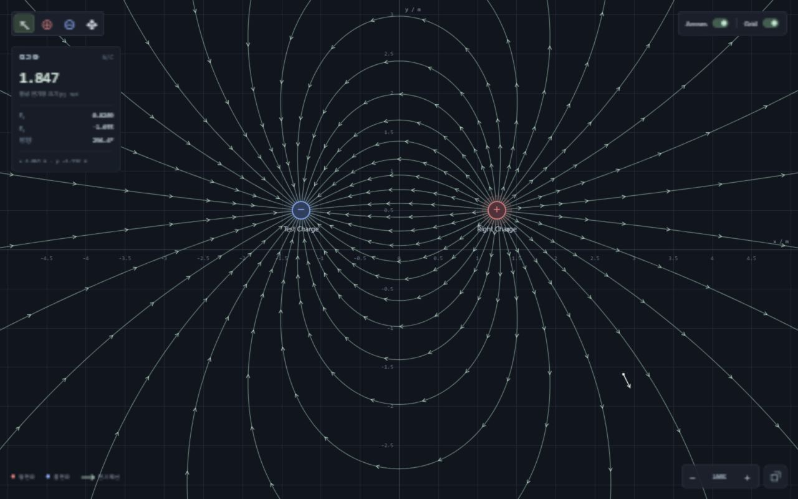

# 기존 프로젝트 업데이트 검증 기록

검증일: 2026-11-02 (Asia/Seoul). 기존 `electric_field_visualizer` 폴더를 직접 수정했습니다.

## 수정 및 추가 파일

| 파일 | 내용 |
|---|---|
| `index.html` | 장식성 제목·부제 제거, 이름 입력, 필드 내부 스위치·최대화 도구, 측정 좌표 |
| `css/field-controls.css` (추가) | 간결한 레이아웃, 반투명 컨트롤, 브라우저 내부 최대화, Canvas 크기 처리 |
| `js/main.js` | 최대화·복원, 포인터·리사이즈 처리, 독립적인 ID와 표시 이름, 이름 번호 재사용 |
| `js/ui.js` | 이름 검증·편집·목록, 스위치 양방향 동기화, 컨트롤 표시 설정, Esc 복원 |
| `js/renderer.js` | 사용자 이름의 Canvas 라벨, 긴 이름의 시각적 말줄임 |
| `js/physics.js` | 이름 유틸리티와 JSON 메타데이터 검증·구버전 호환. 전기장 계산 함수는 그대로 유지 |
| `tests/physics.test.cjs` | 이름이 추가된 새 JSON의 왕복 검증 반영 |
| `tests/metadata.test.cjs` (추가) | 이름·번호·ID·JSON 호환성 및 프리셋 수치 회귀 검증 |
| `tests/fixtures/field-baseline.json` (추가) | 수정 전에 수집한 5개 프리셋의 전기력선 기준값 |
| `README.md` | 새 기능·이름 규칙·JSON 호환·검증 명령 설명 |
| `artifacts/named-scene.json` (추가) | 실제 브라우저에서 저장하고 다시 불러온 사용자 이름 포함 JSON |
| `artifacts/update-layout.jpg` (추가) | 사용자 이름을 표시하는 일반 레이아웃 캡처 |
| `artifacts/update-maximized.jpg` (추가) | 내부 도구·스위치·복원 버튼을 표시하는 최대화 캡처 |
| `artifacts/UPDATE_TEST_RESULTS.md` (추가) | 이 검증 기록 |

`js/fieldLines.js`, `js/worker.js`, 기존 기본 테마 `css/style.css`, `serve.cjs`는 수정하지 않았습니다. 다른 프로젝트는 수정하지 않았습니다.

## 자동 테스트

```powershell
node --test tests/physics.test.cjs tests/metadata.test.cjs
```

**23개 통과, 실패 0.** 실행 시 전체 약 1.29초, 20개 전하·320개 선 계산 약 424ms였습니다. 실행 시간은 당시 호스트 부하에 따른 참고값입니다. 모든 JS 파일의 문법 검사도 통과했습니다.

기존 15개 물리 테스트에 다음 8개 검증을 추가했습니다.

1. 현재 비어 있는 가장 작은 Q 번호 선택. 내부 ID와 표시 번호의 독립성.
2. 이름 변경, 공백 정리, 빈 이름·중복·줄바꿈·40자 초과 이름 거부.
3. 실제 과거 `sample-scene.json`에 자동 이름·기본 컨트롤 표시 설정 부여.
4. 이름·ID가 있는 레코드와 없는 레코드를 섞어 불러와도 충돌 없이 정규화.
5. 사용자 이름·내부 ID·독립적인 `showFieldControls` 설정의 JSON 왕복.
6. 중복 이름·ID와 잘못된 표시 설정을 적용 전에 거부.
7. 표시 이름 유무가 Ex·Ey·|E|·방향에 영향을 주지 않음.
8. **5개 프리셋의 모든 선 계산점이 수정 전 기준값과 일치**. 소수점 7자리로 정규화한 전체 좌표·방향·종료 정보의 해시를 비교.

회귀 비교 조건: 카메라 중심 (0,0), 확대율 100 CSS px/m, 영역 1000×650, 기본 밀도 32. 수정 전후 선 개수는 단일 양전하 32, 단일 음전하 32, 쌍극자 44, 두 양전하 64, 불균등 전하 31개로 모두 같았습니다.

## 실제 브라우저 검증

Node 로컬 서버 `http://127.0.0.1:8001`, Chromium 기반 브라우저에서 실행했습니다. 데스크톱 검증을 위해 1280×800 뷰포트를 적용하고 마지막에 임시 크기 설정을 해제했습니다.

| 항목 | 실제 확인 결과 |
|---|---|
| UI 정리 | Field Explorer / Custom Experiment / Field 제목·부제가 제거됨. 실제 측정 정보는 유지 |
| 최대화 | Canvas가 (0,0)에서 정확히 1280×800을 채움. 헤더·사이드바·외부 도구·상태바 숨김 |
| 해상도 | 일반 Canvas 980×668 → 최대화 1280×800으로 버퍼도 갱신 |
| 좌표·확대율 유지 | 최대화 직전과 직후 전하 (-1,0), 확대율 100% 유지 |
| 전하 드래그 | 최대화 중 Left Charge가 (-1,0)에서 약 (-1.3502,0.3980)로 이동하고 선 갱신 |
| 확대·축소 버튼 | 최대화 중 조작 후 물리 좌표 유지 |
| 마우스 휠 | 최대화에서 100% → 120% → 100%. 커서 좌표 (약 2.865,-1.592)m 유지, 선택 모드에서 기존 전하 좌표 유지 |
| Pan | 최대화 중 빈 공간 드래그로 시점 이동, 전하의 실제 좌표 유지 |
| 최대화 중 추가 | 내부 음전하 도구로 새 전하를 추가하고 선택됨. 복원 후 목록과 편집기에 정확히 반영 |
| 복원 버튼 | 원래 Canvas (300,104), 980×668 및 외부 패널 복원 |
| Esc 복원 | 내부 컨트롤을 숨긴 상태에서도 정상 복원 |
| 작은 창 | 기본 344×524 창에서도 Canvas가 (0,0), 344×524로 최대화됨. 내부 도구와 스위치가 겹치지 않고 복원 버튼 접근 및 Esc 복원 정상 |
| Field Arrows / Grid | 각각 OFF로 바꿔도 선 44개가 남고, 화면에서 선이 유지되는 것을 확인 |
| 스위치 동기화 | 내부 OFF가 사이드바 OFF로 반영. 사이드바 ON도 내부 ON으로 반영 |
| 컨트롤 표시 | 화살표 ON·격자 OFF인 상태에서 컨트롤만 숨김. 최대화·복원 버튼은 계속 접근 가능 |
| 중복 이름 | Q1의 이름을 Q2로 바꾸면 오류 안내. Left Charge로 변경하면 목록·편집기·Canvas에 반영 |
| 부분 삭제 번호 재사용 | Q1,Q2,Q3 생성 → Q2 삭제 → 다음 추가 시 Q2 생성 |
| 전체 삭제 번호 재사용 | 전하 3개 전체 삭제 → 새 전하 이름 Q1 확인 |
| ID와 이름 분리 | 새 Q1을 Test Charge로 바꿔 저장한 JSON에서 내부 ID 5, 이름 Test Charge가 별도 기록됨 |
| JSON 저장·불러오기 | 실제 다운로드 후 파일 내용을 읽고, 다른 프리셋으로 교체한 뒤 다시 불러옴. Test Charge, -2e-9 C, (-1.25,0.5)m 복원 |
| 표시 설정 JSON | Arrows ON / Grid OFF / 컨트롤 숨김 상태가 저장·복원됨 |
| 불러온 후 추가 | ID가 5인 사용자 이름 전하가 존재할 때 새 전하를 Q1로 추가·편집 가능 |
| PNG 내보내기 | 사용자 이름을 표시한 배치에서 저장 버튼 실행 및 완료 안내 확인. 이번 업데이트에서 새 PNG 파일을 직접 다시 열어보지는 않음 |
| 최종 오류 로그 | 브라우저 warning / error 0개 |

## 호환성과 제한

- 쿨롱 법칙, RK4, 출발점·선 개수·화살표 간격 알고리즘은 그대로 유지했습니다. 5개 프리셋 수치 비교와 기존 물리 테스트로 회귀를 확인했습니다.
- JSON은 version 1을 유지합니다. 기존 파일에는 이름과 `showFieldControls` 기본값을 보완합니다. 새 파일에는 `name`과 해당 설정을 저장하며, 유효한 ID를 유지합니다.
- 최대화는 CSS로 브라우저 내부 가용 영역을 채웁니다. F11이나 OS 전체 화면 상태를 바꾸지 않습니다. 최대화 자체는 JSON에 저장하지 않습니다.
- 이름은 40자 이하, 대소문자를 무시한 중복을 금지합니다. 긴 Canvas 라벨은 최대 약 140px로 줄여 보이지만, 실제 이름은 목록의 툴팁·속성·JSON에 보존됩니다.
- 이번 변경 요구사항에 미구현 기능은 없습니다. 다른 브라우저·실제 터치 장치의 조작은 이번 작업에서 검증하지 않았습니다. 기존 수치 정밀도 및 전하 개수 제한은 유지됩니다.


